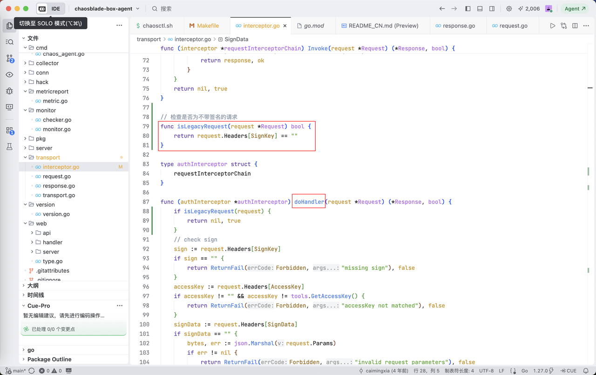
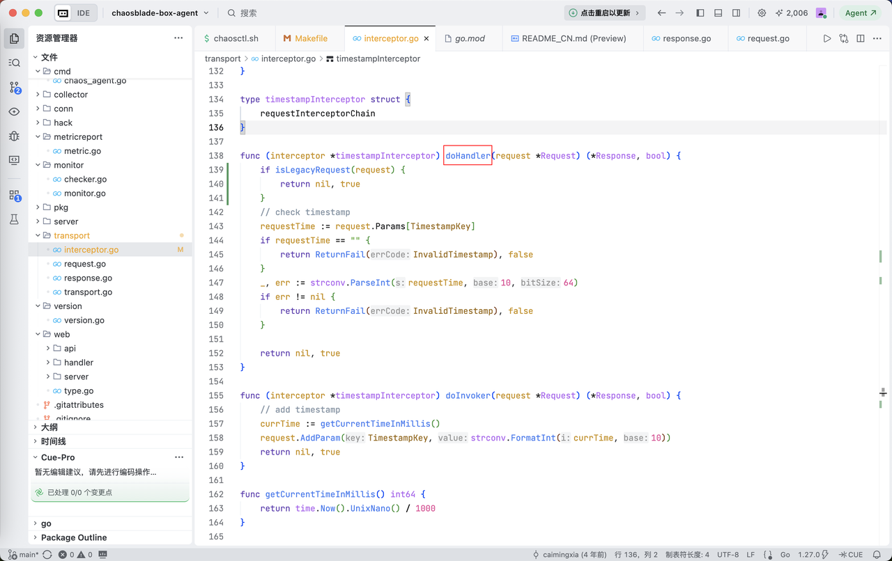

因工作需要熟悉了混沌工程整个ChaosBlade项目的部署和演练测试，从第一次听说到摸清它的全套玩法零零总总花了2个多月的时间，收获很多。因着这个项目，第一次了解到了JVM Sandbox这套字节码增强注入工具，它是混沌指令能够侵入Java应用进程的底层原因，确实强大。

在我的macOS跑通了POC验证（一个修改Java应用运行时状态返回值的案例）之后，我以为将整套工程部署在公司内网Centos7系统(3.10内核)是一件顺风顺水的事，结果整套项目搭起来后，Box平台不管是与同机器Agent通信还是与跨机器Agent进行命令交互，Agent日志里都显示ping指令出现预料之外的"invalid timestamp"报错，第一时间就去翻GitHub Issue记录，查到已经有其他人反馈同样的问题，见[**chaosblade-box项目219缺陷**](https://github.com/chaosblade-io/chaosblade-box/issues/219)。

<!--more-->

奇怪的是，使用同样的Box和Agent版本在我的macOS和阿里云ECS(5.10内核)系统部署测试都能成功，压根没出现过"invalid timestamp"问题。顺理成章地将原因怀疑到公司Centos7系统Linux内核版本太低上。

找同事一起排查、降低ChaosBlade版本(从默认的1.8.0先降低到1.7.6再降低到1.6.1)、降低ChaoBlade-box版本(从1.1.0降到1.0.5)、使用高内核版本Centos8(4.18内核)部署测试，尝试各种方法，都没能解决问题。

最后从源码角度出发，在chaosblade-box-agent项目transport/interceptor.go程序中新增isLegacyRequest方法，并在两处doHandler方法调用前增加isLegacyRequest检查判断，当Box发送过来的请求头中没有携带"sn"参数时直接返回true跳过鉴权处理，配置好Go语言环境，进入项目目录先使用`make build_amd64`编译，编译成功后使用`make package ARCH=amd64`打包，使用打包得到的tar.gz压缩包进行部署，终于解决"invalid timestamp"报错问题，演练测试成功。

核查chaosblade-box项目源码发现，Box给Agent发送ping指令请求中确实没有携带"sn"参数。

修复方法已同步反馈到ChaosBlade钉钉群和GitHub，在这里做一个简短的记录。